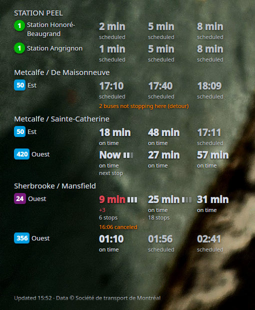
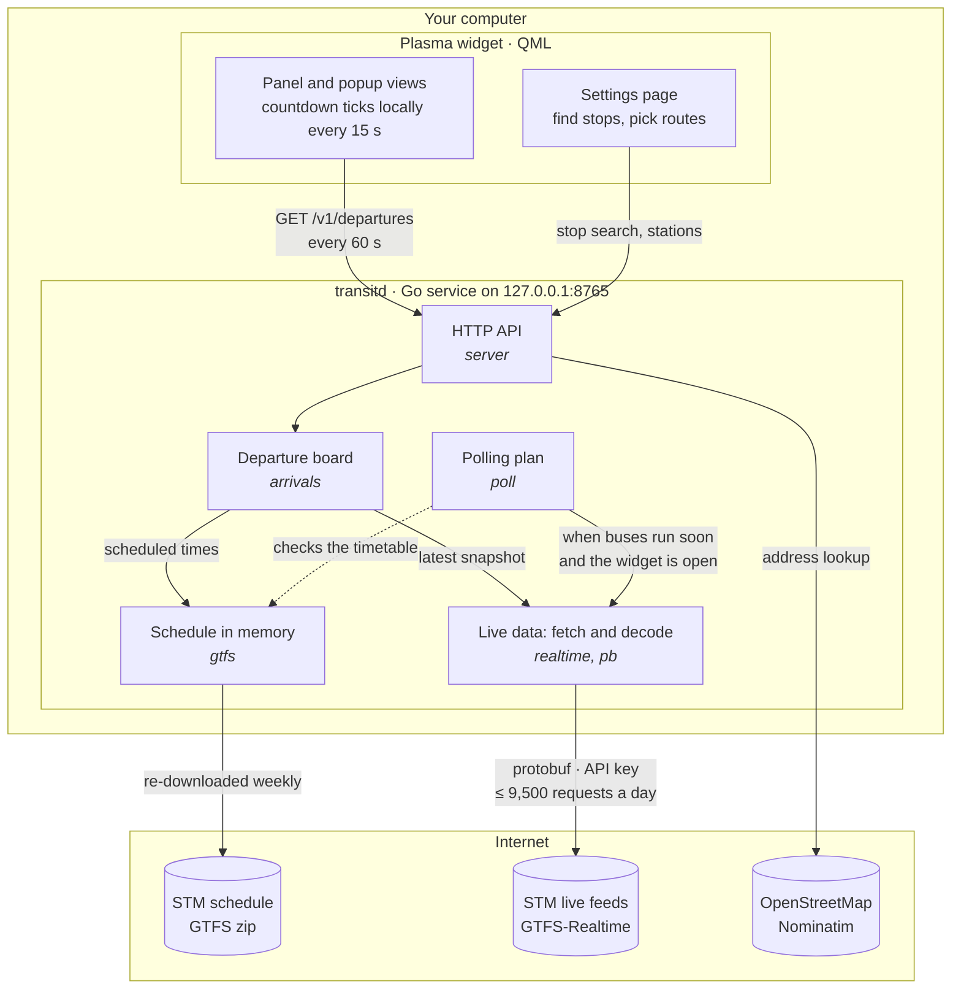

# stm_tracker_widget

A KDE Plasma 6 widget showing the next departures for Montréal STM buses and
metro, with live delays and bus occupancy.

<p align="center">
  
</p>

Two parts:

- **`transitd`** — a small Go service that reads STM's schedule (GTFS) and
  real-time feeds (GTFS-Realtime) and serves simple JSON on localhost.
- **the plasmoid** (`package/`) — plain QML that displays that JSON. No
  transit logic, no C++ plugin.

## Architecture



The widget never talks to STM. Every 60 seconds it asks `transitd` for the
stops it shows, and the service answers from memory: the schedule it keeps
loaded, merged with the latest live snapshot. One background loop fetches
the live feeds, and only when it's worth it: a widget has asked recently and
a bus on a watched route leaves soon. Overnight, or with the widget closed,
it makes no requests at all. That keeps the API key on one machine and
usage far below STM's daily limit, however many widgets are open.

## Status

- [x] Static schedule loader: next departures per route and direction,
      metro frequencies, after-midnight trips, holiday exceptions
- [x] Per-agency config (any GTFS agency), pluggable geocoder
      (OpenStreetMap by default, Google optional), nearby-stop search
- [x] Schedule-aware polling: pauses after the last departure on watched
      routes and resumes 30 min before the first one
- [x] Real-time delays, stops away, occupancy, cancellations and detours,
      decoded with a small hand-written protobuf reader (no dependencies)
- [x] Request budget (stops before STM's daily limit), backoff on errors,
      API key kept out of logs
- [x] HTTP API on localhost (`transitd serve`): departures, stop search,
      nearby stops, status; downloads and refreshes the schedule itself
- [x] Plasmoid: panel view (next departure of your top route), full view
      per stop, settings page with address search
- [x] Screenshot and architecture diagram

## Try it

```sh
go build -o transitd ./cmd/transitd
./transitd serve                          # the service (see below)
./transitd fetch                          # downloads STM's schedule data
./transitd search berri                   # find stop/station IDs
./transitd next -stop <ID> -routes 24 -n 3
./transitd nearby "1500 rue Berri"        # stops near an address
./transitd plan -stop <ID> -routes 24     # would it poll right now?
./transitd live -stop <ID> -routes 24     # next departures with live data
```

## Running the service

```sh
go build -o ~/.local/bin/transitd ./cmd/transitd
cp examples/transitd.service ~/.config/systemd/user/
systemctl --user enable --now transitd
journalctl --user -u transitd -f
```

It listens on `127.0.0.1:8765` and only answers requests addressed to
localhost. On first start it downloads the schedule (about 45 MB), and
again when the copy is a week old.

Polling follows the widget: STM is only asked for live data while the
widget is requesting a stop, there is service on the watched routes within
`wake_lead`, and the day's request budget isn't spent. With the widget closed
for `idle_after`, or overnight, the service makes no requests at all.

### API

All responses are JSON; errors are `{"error": "..."}` (503 while the
schedule is still loading). Times are ISO 8601 with the agency's offset.

| Request | Returns |
| --- | --- |
| `GET /v1/departures?stop=ID&routes=24,165&n=3` | the board: next `n` per route and direction |
| `GET /v1/stops?q=berri` | stops and stations by name or sign number |
| `GET /v1/stops/nearby?address=1500 rue Berri&radius=500` | stops near an address (or `lat=&lon=`) |
| `GET /v1/stops/{id}` | one stop and its routes |
| `GET /v1/stations` | métro stations |
| `GET /v1/status` | schedule, polling state, last error, requests used today |

A departure looks like:

```json
{
  "trip_id": "301004275",
  "scheduled": "2026-10-14T12:36:00-04:00",
  "expected": "2026-10-14T12:39:39-04:00",
  "minutes": 20,
  "status": "late",
  "delay_seconds": 219,
  "realtime": true,
  "frequency": false,
  "stops_away": 14,
  "occupancy": 2
}
```

`status` is `scheduled`, `on_time`, `late`, `early`, `canceled` or
`skipped` (detour). `frequency` marks metro times, which are "a train about
every N minutes". `stops_away` is null when unknown; `occupancy` is 0
(unknown) to 3 (standing room). The response's `live.state` is `live` or
`schedule`; then `live.reason` says why as a code (`no_key`,
`unauthorized`, `budget`, `error`, `no_service`, `starting`, `no_feed`) and
`live.note` in words ("no service until 05:30"). The widget must show `credits`.

## Installing the widget

With `transitd` running (above):

```sh
kpackagetool6 -t Plasma/Applet -i package/     # first time; -u package/ to update
```

Then right-click the desktop or a panel → Add Widgets → "STM Transit", and
open its settings to find your stops by address. The first stop's first
ticked route is the one the panel shows.

Developing: `sudo dnf install plasma-sdk`, then
`plasmoidviewer -a io.github.tcurrie11.stmtransit` runs it in a window with
`console.log`/`console.warn` output in the terminal (add
`-c org.kde.panel -l topedge -f horizontal` to try it in a panel).

## Configuration

Optional: copy `examples/config.json` to `~/.config/stm-transit/config.json`.
Without it, STM is used with the defaults.

The API key (free, from the [STM developer portal](https://portail.developpeurs.stm.info/apihub/#/login))
is read from the `STM_API_KEY` environment variable, never from the repo.
Keep it in `~/.config/stm-transit/secrets.env` (mode 600):

```sh
STM_API_KEY=your-key-here
```

and load it with `set -a; source ~/.config/stm-transit/secrets.env; set +a`.

Other agencies are added as extra entries in `agencies`.

`go test ./...` runs the tests against a small built-in schedule and real
STM realtime feeds captured on 2026-10-14 (`internal/realtime/testdata`).

## How live times are worked out

STM's trip updates give a predicted time for each stop still ahead of each
bus; delay is predicted minus scheduled. Vehicle positions give the stop each
bus is heading to and how full it is (three levels: seats free, few seats,
standing room). Two details of STM's feed that the code relies on:

- skipped stops (detours) are listed *after* all the other stops of a trip,
  out of sequence order, so nothing assumes the list is sorted;
- the metro has no realtime data, so metro times are always "scheduled".

## Project layout

```
cmd/transitd/        command line: `serve` plus terminal tools (search, next, live…)
internal/
  gtfs/              static schedule: loading the GTFS zip, next-departure queries
  pb/                minimal protobuf reader (no generated code or dependencies)
  realtime/          GTFS-Realtime decoding, polite fetching, matching to the schedule
  arrivals/          the departure board: schedule and live data merged
  poll/              when live data is worth fetching
  server/            the background service and its JSON API
  config/, geo/      settings and address lookup
package/             the Plasma 6 widget (QML)
examples/            sample config and systemd user unit
```

`transitd version` prints the version (currently 0.1.0).

## License

GPL-2.0-or-later, see [LICENSE](LICENSE). Author:
[TCurrie11](https://github.com/TCurrie11).

Transit data © Société de transport de Montréal, CC BY 4.0.
